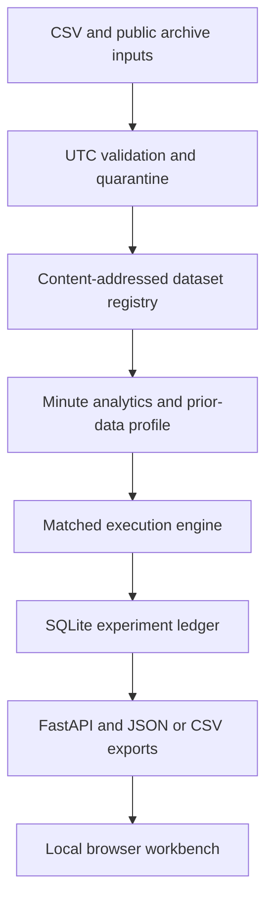

# Architecture and software engineering

The numerical engine does not depend on HTTP or the browser. `data.py` is the ingestion boundary; `analytics.py` builds bars and diagnostics; `engine.py` contains scheduling and cost accounting; `store.py` owns transactional SQLite operations; `app.py` defines typed routes. The frontend uses vanilla JavaScript and SVG, so a user needs no Node tooling to run it.

- CSV imports are bounded and validated. Original files and rejected rows survive registration.
- Dataset directories are staged and atomically installed; duplicate registrations reuse content IDs.
- Quote lookup is backward as-of with explicit staleness. Missing quotes trigger labelled proxy assumptions.
- A request is synchronous and limited to six hours of minute data. Batch requests accept at most twelve windows. For longer workloads, a queue/worker architecture would be required.
- SQLite uses WAL and per-operation connections/transactions, with uniqueness enforcing idempotence under concurrent writes.
- OpenAPI documents typed schemas. Unknown request fields and non-finite numbers are rejected. POST body limits are enforced through the declared Content-Length and model string caps. The app is intended for loopback use; production transport-level limits remain a deployment concern.
- The browser renders user-provided dataset metadata using text nodes rather than HTML. Charts construct SVG only from numerical data and fixed styles. A restrictive Content Security Policy disallows external scripts and framing.
- HTTP timing headers, request counts and structured access logging support local operational diagnosis. There is no monitoring service, SLO or external deployment claim.
- API JSON downloads include exact assumptions, source files and code fingerprint. CSV exports retain zero-fill minutes and fill reference labels.
- A Dockerfile and CI workflow are included as delivery configuration. The image builds and serves locally, and the CI steps pass inside it; neither is a claimed deployment.
- Stored CSV and JSON files use LF line endings on every operating system, so content-derived dataset and experiment IDs are platform-independent.

## API design decisions

A dataset is immutable once registered. An experiment is immutable and keyed by content. There are no delete or live-trading endpoints. This intentionally keeps research artefacts inspectable. The dashboard restores exact prior results; it does not silently recompute old experiments with newer code.

## Extension points

Exchange adapters can normalize licensed trade/quote sources into the documented schema. Multiple asset classes require correct units, tick/lot sizes and instrument metadata before interpretation. True order-book execution would require depth events, a queue model and calibration. An authenticated team service would need workspace-level access control and background jobs. These extensions are not part of the present implementation.
